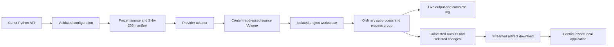

# Architecture and extension points

Skyrun keeps project code independent of infrastructure. The core owns
configuration, source policy, immutable staging, run records, and sync conflicts.
An adapter owns provider credentials, images, transport, and execution lifecycle.



## Python API

```python
from skyrun import download, load_config, run

config = load_config("/path/to/skyrun.toml")
result = run(config, gpu="L4", command=["python", "train.py", "--epochs", "5"])
print(result.run_id, result.status, result.returncode, result.directory)

# Download committed artifacts without starting another workload.
directory = download(result.run_id, config, output_dir="/tmp/recovered")
```

`run()` accepts a `Config`, a configuration path, or discovery from the current
directory. It returns `RunResult`, with raw metadata available as `.data` and
optional `.sync_report`. Expected errors derive from `SkyrunError`, including
`ConfigError` and `SyncConflict`. Normal workload failures return a nonzero result;
transport or configuration failures raise. `run()` uses process signal handlers
and must run on the main thread. The API is synchronous.

Use `sync=False` to defer local application. A sync conflict raises after the run
record and downloaded artifacts have been saved. Recover later with
`download(run_id, config, sync=True, conflict="local")`, or inspect the remote
versions in the run directory. `conflict="remote"` explicitly replaces conflicting
regular local files. See [sync semantics](synchronization.md).

## Package map

| Module | Responsibility |
| --- | --- |
| `config.py` | Discovery, typed config container, defaults, validation |
| `manifest.py` | Ignore policy, bounded staging, file modes, hashes, deterministic bundles |
| `locking.py` | Local OS project lock shared by source snapshots and sync application |
| `runner.py` | Provider-neutral orchestration, run records, Python API |
| `providers/` | Adapter protocol, entry-point discovery, optional Modal implementation |
| `remote/engine.py` | POSIX subprocess, PTY/pipes, process-group cleanup, harvest |
| `remote/app.py` | Modal handshake, verified source reconstruction, Volume commits |
| `session.py` | Local signals, raw output decoding, startup and stop handshake |
| `sync.py` | Selected-file harvesting, integrity validation, local conflict handling |
| `examples/` | Runnable projects included in wheel and source distributions |

## Adding a provider

Modal is the shipped backend. Third-party packages can expose another provider
without changing core source scanning or local sync policy:

```toml
[project.entry-points."skyrun.providers"]
mycloud = "mycloud_skyrun:MyProvider"
```

An entry point loads a zero-argument provider class implementing
`skyrun.providers.Provider`:

```python
class MyProvider:
    def run(self, config, source, spec, destination) -> dict:
        # Upload source.project according to source.manifest.
        # Stream logs, honor stop requests, and commit artifacts.
        # Return a JSON-serializable execution record.
        ...

    def download(self, config, run_id, destination) -> int:
        # Stream committed artifacts into destination; return file count.
        ...
```

Set `provider = "mycloud"` in configuration and place backend-specific values in
`[provider_options]`. Duplicate registrations and missing methods fail explicitly.
The `modal` name is reserved for the built-in backend. `Snapshot.archive()` offers
a deterministic in-memory ZIP for backends that prefer a bundle; the Modal
adapter streams missing content blobs instead.

Adapters must preserve the source manifest, argv semantics, isolated workspace,
and result fields `status`, `returncode`, and `elapsed_seconds`. Persist metadata
under `_runner/`; selected changes follow the `_sync` format produced by
`collect_sync`. Prevent remote paths from overwriting local run metadata. A
backend with compatible POSIX hosts can reuse `remote.engine.run_workload`; the
default filesystem paths and Volumes in `remote.app` are Modal-specific.

Adapters should implement the start handshake and stop escalation before claiming
parity with the Modal backend. Add contract tests and an explicitly enabled live
smoke. The extension contract is versioned with the pre-1.0 Skyrun package and may
evolve before 1.0; pin a compatible minor release in adapter dependencies.
